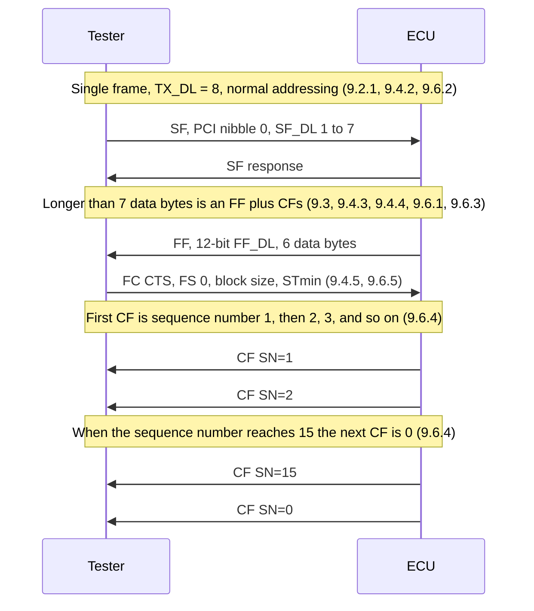

# Architecture

```
 app (emulator) --TCP--> [fakeobd] ELM327 line server           crates/fakeobd
                            |  one line in, bytes + prompt out
                         [elm]  AT / ST command layer,           crates/elm
                            |   ISO-TP tester endpoint, filters, timeouts
                         [vehicle::Bus]  frames + virtual time   crates/vehicle
                            |   ISO-TP endpoint per ECU
                         [vehicle::Ecu]  J1979 + UDS read services
                            |
                         [obd-policy]  judge + audit every request   crates/obd-policy
```

| Crate | Role | Depends on |
|---|---|---|
| `obd-policy` | allow/deny rules, hard floor, audit log, ELM line classifier. No I/O, no CAN. | nothing |
| `isotp` | ISO-TP framing, segmentation, reassembly, flow control, STmin. | nothing |
| `vehicle` | profile parser, ECUs, bus with virtual time, fault injection. | `isotp`, `obd-policy` |
| `elm` | the adapter: command state, ISO-TP tester side, receive filter, output formatting. | `isotp`, `vehicle`, `obd-policy` |
| `obd-conform` | transcript format, normalisation, replay, capture, compare, loopback-only TCP client. | nothing |
| `fakeobd` | binary and `Sim` wiring: TCP server, `verify`, CLI. | all of the above |

First-party only: no external dependencies. `unsafe` is forbidden by the workspace lint table.

## Time

Nothing sleeps. The bus returns each ECU frame with a millisecond offset after the frame that provoked it,
and the adapter decides from those offsets and its timeout (`ATST`) what it saw: a frame later than the
window after the previous one is dropped, which is how a slow ECU becomes `NO DATA`. The adapter reports the
virtual time it was busy; with `--realtime` the server sleeps that long, and a byte arriving meanwhile
abandons the request with `STOPPED`. Session timers (the `$10` S3 timeout) run on the bus's virtual clock;
the server advances it by wall-clock idle time in `--realtime` mode only.

## One connection, one vehicle

Each TCP connection builds its own bus from the same description, so sessions, request counters and fault
counters are independent. The audit sink (a JSON-lines file) is shared.

## Addressing

11-bit identifiers only. Physical requests to an ECU's `req` ID; the functional ID `7DF` reaches every ECU
marked `functional=yes`. The adapter's default receive filter is `7E8..7EF`; `ATCRA`, `ATCF` and `ATCM`
change it, which is why a request to the cluster at `244` needs `ATCRA644` (as the Voltage app does).

## ISO-TP exchange

Classic CAN, TX_DL = 8, normal addressing. A multi-frame request uses the same PDUs in the other direction:
the tester sends the first frame, the ECU sends the flow control, and the tester sends the consecutive frames.
`iso:15765-2@2016§9.4.5`.



### Where a read sentence and the code differ

Read 2026-11-21 from `iso:15765-2@2016`. Protocol behavior is unchanged.

- `iso:15765-2@2016§9.6.4`: an intermediate consecutive frame's CAN_DL has to match the RX_DL taken from the first frame, and only the last consecutive frame may be shorter. `Reassembler::push` keeps the bytes the frame carries, up to the length still expected.
- `iso:15765-2@2016§9.6.2¶23`: when padding is in use, a single frame whose CAN_DL is not 8 is ignored. `decode` accepts a single frame whenever SF_DL is 1..=7 and fits in the frame, which is how a padded frame and an unpadded frame both reassemble. The same sentence's SF_DL 0 and over-long SF_DL conditions are what the decode rejects.
- `iso:15765-2@2016§9.6.1` and `iso:15765-2@2016§9.6.3`: a message longer than 4095 bytes uses the four-byte FF_DL escape. `segment` returns `TooLong` for that length. A received escape has a 12-bit length of 0 and fails as a short first frame.
- `iso:15765-2@2016§9.6.2` and `iso:15765-2@2016§9.6.3`: a bad single frame or a too-short first frame is ignored. `decode` rejects those frames. `Reassembler::push` also clears a reception already in progress when `decode` fails.
- `iso:15765-2@2016§9.6.5`: a flow-control frame with a reserved flow status aborts the segmented transmission. `decode` returns `BadFlowControl`. `Ecu::on_frame` leaves the unsent consecutive frames in place, so a later continue-to-send still transmits them. The adapter's `exchange` stops when the queue holds no decodable flow-control frame.
- `iso:15765-2@2016§9.6.5`: STmin 0xF1..=0xF9 means 100..=900 µs, and a reserved STmin means 127 ms. `st_min_us` returns those values. `Ecu::on_flow` and `Elm::exchange` add `st_min_us / 1000` milliseconds on the virtual clock, so a separation below 1 ms adds no further delay.

## Fault injection

One fault per line, shared by the `--faults` file and the transcript `@ fault:` header.

```text
bus request=2 ecu=7E8 delay_ms=500    # every response frame 500 ms late: NO DATA inside a 200 ms window
bus drop_frame=2                      # lose the third frame of a multi-frame response
bus bad_sequence=1                    # corrupt the first consecutive frame's sequence number
bus pending_ms=1200                   # 7F <sid> 78 first, the answer 1200 ms later
bus request=3 can_error               # the transmit fails: CAN ERROR
bus fc_overflow | fc_wait=3 | fc_block=4,0A      # ECU as receiver of a multi-frame request
bus silent                            # the ECU never answers
adapter reset_after=5                 # after the fifth line the adapter reboots: banner, state reset
adapter drop_after=9                  # the adapter closes the connection
```

`request` is the 1-based index of the request on the connection (a single frame or first frame from the
tester); omit it for every request. `ecu` is the ECU's response ID; omit it for all.

## Reusing the policy in a relay

`obd-policy` takes application-layer bytes (service identifier first) and returns a `Decision`. A relay
between an app and a real adapter would:

1. read ELM lines from the app, `classify_line` each one;
2. forward `Adapter` lines, **refuse `Bypass` lines** (`ATCAF0`, `ATPP`, `STPX`, ... which can put bytes on
   the bus or reprogram the adapter without passing through a request);
3. for a `Request`, ask `Policy::evaluate(&pdu)`; on `Deny` answer the app with `7F <sid> <nrc>` itself and
   never forward the line; on `Allow` forward it;
4. record every decision with `AuditLog::record`.

What the relay cannot see from a line alone: a multi-line request built from adapter state (`ATCAF0` with
raw frames, which `Bypass` refuses), and requests a bus-side tool sends by another route. 

### The API, and streams

```rust
let mut f = Filter::new(Policy::read_only()).with_sink(Box::new(my_sink));   // AuditSink
match f.decide(&pdu, &Context::new("7E0")) {                                  // application-layer bytes
    Action::Allow => forward(pdu),
    Action::Deny { .. } => reply(action.negative_response()),                 // 7F <sid> <nrc>
    Action::Rewrite(new) => forward(new),                                     // judged again
}
f.decide_line("22 41 AD", &ctx)  // ELM text: Forward | Respond(hex) | Refuse | Rewrite(line)
```

For gattmirror's `serial_stream::ByteStream` contract: `fakeobd::SimPipe` is the simulator in process, and
`crates/serial-bridge` (its own manifest, because it has a path dependency outside this repository)
implements `ByteStream` for it (`SimStream`) and provides `PolicyStream<S: ByteStream>`, a relay that sits
between any frontend stream and any backend stream. Its local refusals are not echoed and ignore the
backend's linefeed setting (fine for apps that send `ATE0` first).

### Golden transcripts against real hardware

The capture and compare workflow, the format and the gap mechanism are in
[transcript-format.md](transcript-format.md); `capture` works against any ELM327-over-TCP endpoint, including
a bridge in front of an OBDLink MX+ or other STN adapter.
